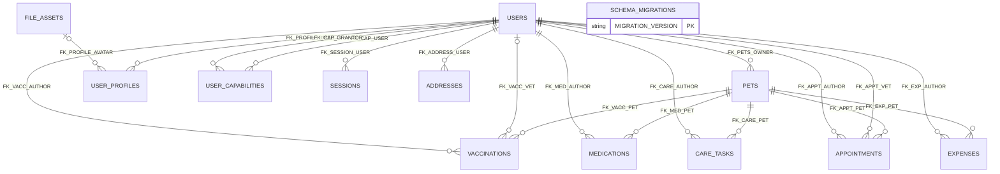
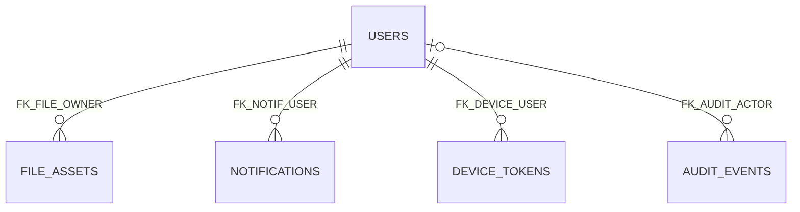
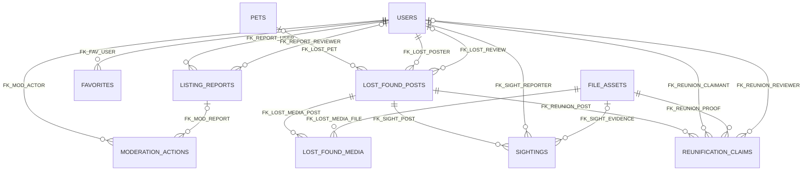
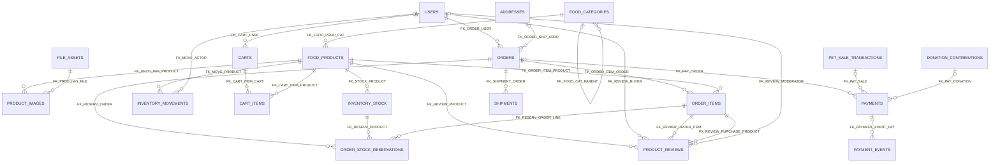
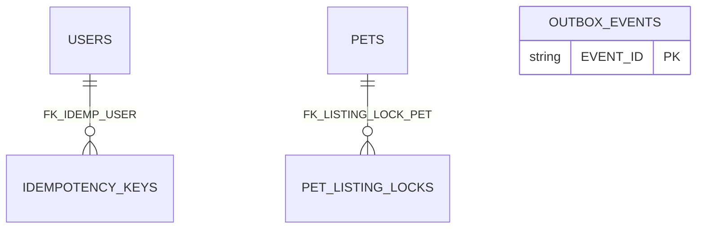

# PawCare Oracle Database — Entity–Relationship Diagrams

> Generated directly from the Oracle `V001`–`V012` foreign-key constraints. **Source of truth:** versioned migrations, not a hypothetical model. Relationships in diagrams represent the **declared database FKs**; application-level polymorphic references and business ownership rules are documented separately.

**Scope:** 50 tables including `SCHEMA_MIGRATIONS`, 99 foreign keys, and 4 public views (views are not independent base entities).

## Relationship legend

- `PARENT ||--o{ CHILD` means one parent can be associated with many child rows, and the child FK is required.
- `PARENT o|--o{ CHILD` is used here for nullable child foreign keys (a child may have no referenced parent).
- These are *link cardinality sketches*, not a proof of maximum/minimum business records, alternate keys, or exclusive cross-table conditions; review the check and unique constraints in the dictionary.

## Domain diagrams

### A. Accounts and core care

**Primary entities:** `SCHEMA_MIGRATIONS`, `USERS`, `PETS`, `VACCINATIONS`, `MEDICATIONS`, `CARE_TASKS`, `APPOINTMENTS`, `EXPENSES`, `USER_PROFILES`, `USER_CAPABILITIES`, `SESSIONS`, `ADDRESSES`.

### B. Media, notifications and audit

**Primary entities:** `FILE_ASSETS`, `NOTIFICATIONS`, `DEVICE_TOKENS`, `AUDIT_EVENTS`.

### C. Adoption, donations and pet sales

```mermaid
erDiagram
    PETS o|--o{ ADOPTION_LISTINGS : "FK_ADOPT_PET"
    USERS ||--o{ ADOPTION_LISTINGS : "FK_ADOPT_CREATOR"
    USERS o|--o{ ADOPTION_LISTINGS : "FK_ADOPT_REVIEWER"
    ADOPTION_LISTINGS ||--o{ ADOPTION_MEDIA : "FK_ADOPT_MEDIA_LISTING"
    FILE_ASSETS ||--o{ ADOPTION_MEDIA : "FK_ADOPT_MEDIA_FILE"
    ADOPTION_LISTINGS ||--o{ ADOPTION_APPLICATIONS : "FK_ADOPT_APP_LISTING"
    USERS ||--o{ ADOPTION_APPLICATIONS : "FK_ADOPT_APP_USER"
    USERS o|--o{ ADOPTION_APPLICATIONS : "FK_ADOPT_APP_REVIEW"
    ADOPTION_LISTINGS ||--o{ ADOPTION_HANDOVERS : "FK_HANDOVER_LISTING"
    ADOPTION_APPLICATIONS ||--o{ ADOPTION_HANDOVERS : "FK_HANDOVER_APP"
    ADOPTION_APPLICATIONS ||--o{ ADOPTION_HANDOVERS : "FK_HANDOVER_APP_MATCH"
    PETS ||--o{ ADOPTION_HANDOVERS : "FK_HANDOVER_PET"
    USERS ||--o{ ADOPTION_HANDOVERS : "FK_HANDOVER_PRIOR"
    USERS ||--o{ ADOPTION_HANDOVERS : "FK_HANDOVER_NEW"
    USERS ||--o{ DONATION_CAMPAIGNS : "FK_DONATION_BEN"
    USERS o|--o{ DONATION_CAMPAIGNS : "FK_DONATION_REVIEW"
    DONATION_CAMPAIGNS ||--o{ DONATION_CONTRIBUTIONS : "FK_CONTRIB_CAMPAIGN"
    USERS o|--o{ DONATION_CONTRIBUTIONS : "FK_CONTRIB_DONOR"
    PETS ||--o{ PET_SALE_LISTINGS : "FK_SALE_PET"
    USERS ||--o{ PET_SALE_LISTINGS : "FK_SALE_SELLER"
    FILE_ASSETS o|--o{ PET_SALE_LISTINGS : "FK_SALE_EVIDENCE"
    USERS o|--o{ PET_SALE_LISTINGS : "FK_SALE_REVIEWER"
    PET_SALE_LISTINGS ||--o{ PET_SALE_MEDIA : "FK_SALE_MEDIA_LISTING"
    FILE_ASSETS ||--o{ PET_SALE_MEDIA : "FK_SALE_MEDIA_FILE"
    PET_SALE_LISTINGS ||--o{ PET_SALE_INQUIRIES : "FK_SALE_INQ_LISTING"
    USERS ||--o{ PET_SALE_INQUIRIES : "FK_SALE_INQ_BUYER"
    PET_SALE_LISTINGS ||--o{ PET_SALE_TRANSACTIONS : "FK_SALE_TXN_LISTING"
    PETS ||--o{ PET_SALE_TRANSACTIONS : "FK_SALE_TXN_PET"
    USERS ||--o{ PET_SALE_TRANSACTIONS : "FK_SALE_TXN_SELLER"
    USERS ||--o{ PET_SALE_TRANSACTIONS : "FK_SALE_TXN_BUYER"
```

**Primary entities:** `ADOPTION_LISTINGS`, `ADOPTION_MEDIA`, `ADOPTION_APPLICATIONS`, `ADOPTION_HANDOVERS`, `DONATION_CAMPAIGNS`, `DONATION_CONTRIBUTIONS`, `PET_SALE_LISTINGS`, `PET_SALE_MEDIA`, `PET_SALE_INQUIRIES`, `PET_SALE_TRANSACTIONS`.

### D. Moderation and lost & found

**Primary entities:** `LISTING_REPORTS`, `MODERATION_ACTIONS`, `FAVORITES`, `LOST_FOUND_POSTS`, `LOST_FOUND_MEDIA`, `SIGHTINGS`, `REUNIFICATION_CLAIMS`.

### E. Food store, orders and delivery

**Primary entities:** `FOOD_CATEGORIES`, `FOOD_PRODUCTS`, `PRODUCT_IMAGES`, `INVENTORY_STOCK`, `INVENTORY_MOVEMENTS`, `CARTS`, `CART_ITEMS`, `ORDERS`, `ORDER_ITEMS`, `ORDER_STOCK_RESERVATIONS`, `PAYMENTS`, `PAYMENT_EVENTS`, `SHIPMENTS`, `PRODUCT_REVIEWS`.

### F. Reliability and async workflows

**Primary entities:** `OUTBOX_EVENTS`, `IDEMPOTENCY_KEYS`, `PET_LISTING_LOCKS`.

## Complete foreign-key inventory

Every relationship below was extracted from the actual Oracle `FOREIGN KEY ... REFERENCES` clause. Composite columns remain ordered.

| Migration | Child table / columns | FK constraint | Parent table / columns | Nullable? |
|---|---|---|---|---|
| `V001` | `PETS(OWNER_USER_ID)` | `FK_PETS_OWNER` | `USERS(USER_ID)` | No |
| `V001` | `VACCINATIONS(PET_ID)` | `FK_VACC_PET` | `PETS(PET_ID)` | No |
| `V001` | `VACCINATIONS(VETERINARIAN_USER_ID)` | `FK_VACC_VET` | `USERS(USER_ID)` | Yes |
| `V001` | `VACCINATIONS(RECORDED_BY_USER_ID)` | `FK_VACC_AUTHOR` | `USERS(USER_ID)` | No |
| `V001` | `MEDICATIONS(PET_ID)` | `FK_MED_PET` | `PETS(PET_ID)` | No |
| `V001` | `MEDICATIONS(CREATED_BY_USER_ID)` | `FK_MED_AUTHOR` | `USERS(USER_ID)` | No |
| `V001` | `CARE_TASKS(PET_ID)` | `FK_CARE_PET` | `PETS(PET_ID)` | No |
| `V001` | `CARE_TASKS(CREATED_BY_USER_ID)` | `FK_CARE_AUTHOR` | `USERS(USER_ID)` | No |
| `V001` | `APPOINTMENTS(PET_ID)` | `FK_APPT_PET` | `PETS(PET_ID)` | No |
| `V001` | `APPOINTMENTS(VET_USER_ID)` | `FK_APPT_VET` | `USERS(USER_ID)` | No |
| `V001` | `APPOINTMENTS(CREATED_BY_USER_ID)` | `FK_APPT_AUTHOR` | `USERS(USER_ID)` | No |
| `V001` | `EXPENSES(PET_ID)` | `FK_EXP_PET` | `PETS(PET_ID)` | No |
| `V001` | `EXPENSES(CREATED_BY_USER_ID)` | `FK_EXP_AUTHOR` | `USERS(USER_ID)` | No |
| `V002` | `USER_PROFILES(USER_ID)` | `FK_PROFILE_USER` | `USERS(USER_ID)` | No |
| `V003` | `USER_PROFILES(AVATAR_FILE_ID)` | `FK_PROFILE_AVATAR` | `FILE_ASSETS(FILE_ID)` | Yes |
| `V002` | `USER_CAPABILITIES(USER_ID)` | `FK_CAP_USER` | `USERS(USER_ID)` | No |
| `V002` | `USER_CAPABILITIES(GRANTED_BY_USER_ID)` | `FK_CAP_GRANTOR` | `USERS(USER_ID)` | No |
| `V002` | `SESSIONS(USER_ID)` | `FK_SESSION_USER` | `USERS(USER_ID)` | No |
| `V002` | `ADDRESSES(USER_ID)` | `FK_ADDRESS_USER` | `USERS(USER_ID)` | No |
| `V003` | `FILE_ASSETS(OWNER_USER_ID)` | `FK_FILE_OWNER` | `USERS(USER_ID)` | No |
| `V003` | `NOTIFICATIONS(USER_ID)` | `FK_NOTIF_USER` | `USERS(USER_ID)` | No |
| `V003` | `DEVICE_TOKENS(USER_ID)` | `FK_DEVICE_USER` | `USERS(USER_ID)` | No |
| `V003` | `AUDIT_EVENTS(ACTOR_USER_ID)` | `FK_AUDIT_ACTOR` | `USERS(USER_ID)` | Yes |
| `V004` | `ADOPTION_LISTINGS(PET_ID)` | `FK_ADOPT_PET` | `PETS(PET_ID)` | Yes |
| `V004` | `ADOPTION_LISTINGS(CREATOR_ID)` | `FK_ADOPT_CREATOR` | `USERS(USER_ID)` | No |
| `V004` | `ADOPTION_LISTINGS(REVIEWED_BY_USER_ID)` | `FK_ADOPT_REVIEWER` | `USERS(USER_ID)` | Yes |
| `V004` | `ADOPTION_MEDIA(ADOPTION_ID)` | `FK_ADOPT_MEDIA_LISTING` | `ADOPTION_LISTINGS(ADOPTION_ID)` | No |
| `V004` | `ADOPTION_MEDIA(FILE_ID)` | `FK_ADOPT_MEDIA_FILE` | `FILE_ASSETS(FILE_ID)` | No |
| `V004` | `ADOPTION_APPLICATIONS(ADOPTION_ID)` | `FK_ADOPT_APP_LISTING` | `ADOPTION_LISTINGS(ADOPTION_ID)` | No |
| `V004` | `ADOPTION_APPLICATIONS(APPLICANT_ID)` | `FK_ADOPT_APP_USER` | `USERS(USER_ID)` | No |
| `V004` | `ADOPTION_APPLICATIONS(REVIEWED_BY_USER_ID)` | `FK_ADOPT_APP_REVIEW` | `USERS(USER_ID)` | Yes |
| `V004` | `ADOPTION_HANDOVERS(ADOPTION_ID)` | `FK_HANDOVER_LISTING` | `ADOPTION_LISTINGS(ADOPTION_ID)` | No |
| `V004` | `ADOPTION_HANDOVERS(APPLICATION_ID)` | `FK_HANDOVER_APP` | `ADOPTION_APPLICATIONS(APPLICATION_ID)` | No |
| `V004` | `ADOPTION_HANDOVERS(ADOPTION_ID, APPLICATION_ID, NEW_OWNER_ID)` | `FK_HANDOVER_APP_MATCH` | `ADOPTION_APPLICATIONS(ADOPTION_ID, APPLICATION_ID, APPLICANT_ID)` | No |
| `V004` | `ADOPTION_HANDOVERS(PET_ID)` | `FK_HANDOVER_PET` | `PETS(PET_ID)` | No |
| `V004` | `ADOPTION_HANDOVERS(PRIOR_OWNER_ID)` | `FK_HANDOVER_PRIOR` | `USERS(USER_ID)` | No |
| `V004` | `ADOPTION_HANDOVERS(NEW_OWNER_ID)` | `FK_HANDOVER_NEW` | `USERS(USER_ID)` | No |
| `V005` | `DONATION_CAMPAIGNS(BENEFICIARY_ID)` | `FK_DONATION_BEN` | `USERS(USER_ID)` | No |
| `V005` | `DONATION_CAMPAIGNS(REVIEWED_BY_USER_ID)` | `FK_DONATION_REVIEW` | `USERS(USER_ID)` | Yes |
| `V005` | `DONATION_CONTRIBUTIONS(CAMPAIGN_ID)` | `FK_CONTRIB_CAMPAIGN` | `DONATION_CAMPAIGNS(CAMPAIGN_ID)` | No |
| `V005` | `DONATION_CONTRIBUTIONS(DONOR_ID)` | `FK_CONTRIB_DONOR` | `USERS(USER_ID)` | Yes |
| `V006` | `PET_SALE_LISTINGS(PET_ID)` | `FK_SALE_PET` | `PETS(PET_ID)` | No |
| `V006` | `PET_SALE_LISTINGS(SELLER_ID)` | `FK_SALE_SELLER` | `USERS(USER_ID)` | No |
| `V006` | `PET_SALE_LISTINGS(WELFARE_EVIDENCE_FILE_ID)` | `FK_SALE_EVIDENCE` | `FILE_ASSETS(FILE_ID)` | Yes |
| `V006` | `PET_SALE_LISTINGS(REVIEWED_BY_USER_ID)` | `FK_SALE_REVIEWER` | `USERS(USER_ID)` | Yes |
| `V006` | `PET_SALE_MEDIA(SALE_LISTING_ID)` | `FK_SALE_MEDIA_LISTING` | `PET_SALE_LISTINGS(SALE_LISTING_ID)` | No |
| `V006` | `PET_SALE_MEDIA(FILE_ID)` | `FK_SALE_MEDIA_FILE` | `FILE_ASSETS(FILE_ID)` | No |
| `V006` | `PET_SALE_INQUIRIES(SALE_LISTING_ID)` | `FK_SALE_INQ_LISTING` | `PET_SALE_LISTINGS(SALE_LISTING_ID)` | No |
| `V006` | `PET_SALE_INQUIRIES(BUYER_ID)` | `FK_SALE_INQ_BUYER` | `USERS(USER_ID)` | No |
| `V006` | `PET_SALE_TRANSACTIONS(SALE_LISTING_ID)` | `FK_SALE_TXN_LISTING` | `PET_SALE_LISTINGS(SALE_LISTING_ID)` | No |
| `V006` | `PET_SALE_TRANSACTIONS(PET_ID)` | `FK_SALE_TXN_PET` | `PETS(PET_ID)` | No |
| `V006` | `PET_SALE_TRANSACTIONS(SELLER_ID)` | `FK_SALE_TXN_SELLER` | `USERS(USER_ID)` | No |
| `V006` | `PET_SALE_TRANSACTIONS(BUYER_ID)` | `FK_SALE_TXN_BUYER` | `USERS(USER_ID)` | No |
| `V007` | `LISTING_REPORTS(REPORTER_ID)` | `FK_REPORT_USER` | `USERS(USER_ID)` | No |
| `V007` | `LISTING_REPORTS(ASSIGNED_REVIEWER_ID)` | `FK_REPORT_REVIEWER` | `USERS(USER_ID)` | Yes |
| `V007` | `MODERATION_ACTIONS(ACTOR_USER_ID)` | `FK_MOD_ACTOR` | `USERS(USER_ID)` | No |
| `V007` | `MODERATION_ACTIONS(REPORT_ID)` | `FK_MOD_REPORT` | `LISTING_REPORTS(REPORT_ID)` | Yes |
| `V007` | `FAVORITES(USER_ID)` | `FK_FAV_USER` | `USERS(USER_ID)` | No |
| `V008` | `LOST_FOUND_POSTS(PET_ID)` | `FK_LOST_PET` | `PETS(PET_ID)` | Yes |
| `V008` | `LOST_FOUND_POSTS(POSTER_ID)` | `FK_LOST_POSTER` | `USERS(USER_ID)` | No |
| `V008` | `LOST_FOUND_POSTS(REVIEWED_BY_USER_ID)` | `FK_LOST_REVIEW` | `USERS(USER_ID)` | Yes |
| `V008` | `LOST_FOUND_MEDIA(POST_ID)` | `FK_LOST_MEDIA_POST` | `LOST_FOUND_POSTS(POST_ID)` | No |
| `V008` | `LOST_FOUND_MEDIA(FILE_ID)` | `FK_LOST_MEDIA_FILE` | `FILE_ASSETS(FILE_ID)` | No |
| `V008` | `SIGHTINGS(POST_ID)` | `FK_SIGHT_POST` | `LOST_FOUND_POSTS(POST_ID)` | No |
| `V008` | `SIGHTINGS(REPORTER_ID)` | `FK_SIGHT_REPORTER` | `USERS(USER_ID)` | No |
| `V008` | `SIGHTINGS(EVIDENCE_FILE_ID)` | `FK_SIGHT_EVIDENCE` | `FILE_ASSETS(FILE_ID)` | Yes |
| `V008` | `REUNIFICATION_CLAIMS(POST_ID)` | `FK_REUNION_POST` | `LOST_FOUND_POSTS(POST_ID)` | No |
| `V008` | `REUNIFICATION_CLAIMS(CLAIMANT_ID)` | `FK_REUNION_CLAIMANT` | `USERS(USER_ID)` | No |
| `V008` | `REUNIFICATION_CLAIMS(PROOF_ASSET_ID)` | `FK_REUNION_PROOF` | `FILE_ASSETS(FILE_ID)` | No |
| `V008` | `REUNIFICATION_CLAIMS(REVIEWED_BY_USER_ID)` | `FK_REUNION_REVIEWER` | `USERS(USER_ID)` | Yes |
| `V009` | `FOOD_CATEGORIES(PARENT_ID)` | `FK_FOOD_CAT_PARENT` | `FOOD_CATEGORIES(CATEGORY_ID)` | Yes |
| `V009` | `FOOD_PRODUCTS(CATEGORY_ID)` | `FK_FOOD_PROD_CAT` | `FOOD_CATEGORIES(CATEGORY_ID)` | No |
| `V009` | `PRODUCT_IMAGES(PRODUCT_ID)` | `FK_PROD_IMG_PRODUCT` | `FOOD_PRODUCTS(PRODUCT_ID)` | No |
| `V009` | `PRODUCT_IMAGES(FILE_ID)` | `FK_PROD_IMG_FILE` | `FILE_ASSETS(FILE_ID)` | No |
| `V009` | `INVENTORY_STOCK(PRODUCT_ID)` | `FK_STOCK_PRODUCT` | `FOOD_PRODUCTS(PRODUCT_ID)` | No |
| `V009` | `INVENTORY_MOVEMENTS(PRODUCT_ID)` | `FK_MOVE_PRODUCT` | `FOOD_PRODUCTS(PRODUCT_ID)` | No |
| `V009` | `INVENTORY_MOVEMENTS(CREATED_BY_USER_ID)` | `FK_MOVE_ACTOR` | `USERS(USER_ID)` | Yes |
| `V010` | `CARTS(USER_ID)` | `FK_CART_USER` | `USERS(USER_ID)` | No |
| `V010` | `CART_ITEMS(CART_ID)` | `FK_CART_ITEM_CART` | `CARTS(CART_ID)` | No |
| `V010` | `CART_ITEMS(PRODUCT_ID)` | `FK_CART_ITEM_PRODUCT` | `FOOD_PRODUCTS(PRODUCT_ID)` | No |
| `V010` | `ORDERS(USER_ID)` | `FK_ORDER_USER` | `USERS(USER_ID)` | No |
| `V010` | `ORDERS(SHIPPING_ADDRESS_ID)` | `FK_ORDER_SHIP_ADDR` | `ADDRESSES(ADDRESS_ID)` | Yes |
| `V010` | `ORDER_ITEMS(ORDER_ID)` | `FK_ORDER_ITEM_ORDER` | `ORDERS(ORDER_ID)` | No |
| `V010` | `ORDER_ITEMS(PRODUCT_ID)` | `FK_ORDER_ITEM_PRODUCT` | `FOOD_PRODUCTS(PRODUCT_ID)` | No |
| `V010` | `ORDER_STOCK_RESERVATIONS(ORDER_ID)` | `FK_RESERV_ORDER` | `ORDERS(ORDER_ID)` | No |
| `V010` | `ORDER_STOCK_RESERVATIONS(PRODUCT_ID)` | `FK_RESERV_PRODUCT` | `INVENTORY_STOCK(PRODUCT_ID)` | No |
| `V010` | `ORDER_STOCK_RESERVATIONS(ORDER_ID, PRODUCT_ID)` | `FK_RESERV_ORDER_LINE` | `ORDER_ITEMS(ORDER_ID, PRODUCT_ID)` | No |
| `V011` | `PAYMENTS(ORDER_ID)` | `FK_PAY_ORDER` | `ORDERS(ORDER_ID)` | Yes |
| `V011` | `PAYMENTS(SALE_TXN_ID)` | `FK_PAY_SALE` | `PET_SALE_TRANSACTIONS(SALE_TXN_ID)` | Yes |
| `V011` | `PAYMENTS(CONTRIBUTION_ID)` | `FK_PAY_DONATION` | `DONATION_CONTRIBUTIONS(CONTRIBUTION_ID)` | Yes |
| `V011` | `PAYMENT_EVENTS(PAYMENT_ID)` | `FK_PAYMENT_EVENT_PAY` | `PAYMENTS(PAYMENT_ID)` | Yes |
| `V011` | `SHIPMENTS(ORDER_ID)` | `FK_SHIPMENT_ORDER` | `ORDERS(ORDER_ID)` | No |
| `V011` | `PRODUCT_REVIEWS(PRODUCT_ID)` | `FK_REVIEW_PRODUCT` | `FOOD_PRODUCTS(PRODUCT_ID)` | No |
| `V011` | `PRODUCT_REVIEWS(BUYER_ID)` | `FK_REVIEW_BUYER` | `USERS(USER_ID)` | No |
| `V011` | `PRODUCT_REVIEWS(ORDER_ITEM_ID)` | `FK_REVIEW_ORDER_ITEM` | `ORDER_ITEMS(ORDER_ITEM_ID)` | No |
| `V011` | `PRODUCT_REVIEWS(ORDER_ITEM_ID, PRODUCT_ID)` | `FK_REVIEW_PURCHASE_PRODUCT` | `ORDER_ITEMS(ORDER_ITEM_ID, PRODUCT_ID)` | No |
| `V011` | `PRODUCT_REVIEWS(MODERATED_BY_USER_ID)` | `FK_REVIEW_MODERATOR` | `USERS(USER_ID)` | Yes |
| `V012` | `IDEMPOTENCY_KEYS(USER_ID)` | `FK_IDEMP_USER` | `USERS(USER_ID)` | No |
| `V012` | `PET_LISTING_LOCKS(PET_ID)` | `FK_LISTING_LOCK_PET` | `PETS(PET_ID)` | No |

## Relationships not fully expressed by foreign keys

- `LISTING_REPORTS` and `FAVORITES` use `listing_type`/`entity_type` plus ID, a polymorphic target. The backend must validate the target and enforce ownership/visibility.
- `PET_LISTING_LOCKS` references `PETS` directly but its `listing_type` + `listing_id` pair is not a conventional FK to either adoption or sale listings. The backend must lock and verify transactionally.
- Transfers of `PETS.owner_user_id` after successful handovers must preserve `ADOPTION_HANDOVERS`, `PET_SALE_TRANSACTIONS`, and `AUDIT_EVENTS` history; database FKs alone cannot enforce all workflow states.
- `PAYMENTS` has three nullable target FKs and `CK_PAY_ONE_TARGET` requires exactly one; for initial launch, the backend should enable **food-order payments only** until other payment flows receive legal/provider review.
- The food `SHIPMENTS` table is linked to `ORDERS`, not to pet-sale transactions. Do not implement shipping of live animals via this module.
- Four public `VW_PUBLIC_*` views are derived projections and are intentionally omitted from the base-table diagrams.

See [`data_dictionary.md`](data_dictionary.md) for column types, nullability, defaults, and check constraints.

