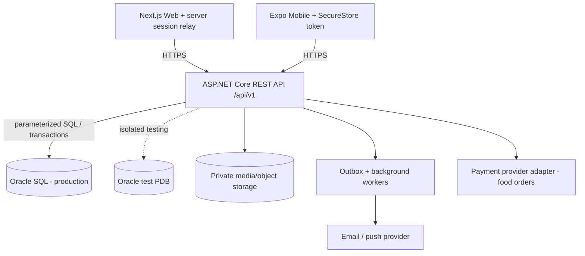

# PawCare — System Architecture

> **Status:** proposed implementation specification (not evidence of completed software)  
> **Version:** 1.1 | **Scope:** rebuild | **Reference:** *PawCare Full Rebuild Blueprint*, 04 November 2026  
> **Implementation decision (06 November 2026):** Oracle-only. This document is a design reference; the actual `database/oracle/` migration files and `docs/DECISIONS.md` are authoritative.

## 1. Objective and scope

PawCare is one pet-care ecosystem delivered through a Next.js web client and a React Native/Expo mobile client. Both use **one ASP.NET Core REST API**; only the backend accesses the relational SQL database. Preserve the original seven care domains and add four requested product areas:

1. Accounts/roles, pet profiles, vaccinations and medication, care tasks, appointments, expenses, veterinarian and administrator workflows.
2. Pet **adoption and rehoming** (an animal transferred to an approved adopter); optional monetary donation campaigns are a **separate, controlled later extension**.
3. Moderated, **lawful** pet buy/sell listings and tracked, safe in-person handover.
4. Lost/found reports, sightings, proof-based reunification.
5. Pet **food** catalogue, cart, checkout, inventory, payment and shipment. Shipping workflow applies to food **only**, never to live animals.

## 2. Technology decisions

| Layer | Chosen technology | Responsibility |
| --- | --- | --- |
| Web | Next.js 16, TypeScript, App Router | Public discovery, owner/vet/admin dashboards; server-side session relay |
| Mobile | React Native + Expo 58, TypeScript, `App.tsx` + React Navigation | Daily care, notifications, camera/photo posts, shopping and account management |
| API | ASP.NET Core 10, C# | JWT auth, permissions, business rules, moderation, transactions and generated OpenAPI |
| Production data | Oracle Database, **versioned SQL** | Relational persistence, integrity, transactional invariants |
| Local/test data | Dedicated, isolated Oracle test PDB/schema | Run Oracle migrations and read-only integration checks without production data |
| Asset storage | Private object storage behind API-mediated signed access | Photos, pet documents, proof of ownership; metadata in SQL |
| Asynchronous work | Backend hosted jobs + SQL outbox | Reminders, notifications, delayed payment and fulfillment events |
| Contracts | OpenAPI + generated TypeScript client/types | Prevent web/mobile contract drift |

**No microservices at MVP stage.** Use a modular monolith, with clear module boundaries. A SQL database is a *relational backend*, not a direct client integration. Do not connect the web browser or mobile app directly to Oracle.

## 3. Logical topology



- Web uses secure `HttpOnly`, `Secure`, `SameSite` cookies and a same-origin relay; avoid placing JWTs in browser local storage.
- Mobile uses secure OS-backed token storage, rotates refresh credentials and never embeds API/database secrets.
- The API owns all money calculations, booking conflicts, stock changes, transfer events, data permissions and moderated publication.
- **Public listings are projections**, not raw database records: never return private addresses, phone numbers, proof documents or exact lost-pet locations.

## 4. Repository structure and responsibility

```text
PawCare/
├── .github/              # CI, security scanning, Dependabot
├── docs/                 # These nine documents
├── database/
│   └── oracle/{migrations,queries,seeds,verification,rollback}/
├── backend/
│   ├── PawCare.Api/{Common,Configuration,Middleware,Security,Infrastructure,Jobs,Modules}/
│   ├── PawCare.Api.Tests/
│   └── PawCare.IntegrationTests/
├── frontend/{app,components,lib,public,tests}/
├── mobile/{src,assets,tests}/
├── packages/{api-contracts,design-tokens}/
├── tests/{api-smoke,e2e-web,e2e-mobile}/
├── scripts/
├── README.md
├── QUICKSTART_WEB.md
├── QUICKSTART_MOBILE.md
├── docker-compose.yml
├── start.bat
└── start-mobile.bat
```

### Backend modules

Use `backend/PawCare.Api/Modules/<Feature>/` with `*Endpoints.cs`, `*Service.cs`, `*Repository.cs`, `*Contracts.cs`, and `*Validation.cs` as applicable:

`Auth`, `Users`, `Pets`, `Medical`, `Care`, `Appointments`, `Expenses`, `Adoption`, `Donations` (optional), `Marketplace`, `LostFound`, `Catalog`, `Inventory`, `Cart`, `Orders`, `Payments`, `Fulfillment`, `Media`, `Notifications`, `Moderation`, `Admin`, `Reports`.

- **Endpoints:** route mapping, auth metadata, input/response, no business-critical SQL.
- **Service:** invariants, authorization/ownership, transaction orchestration, state transitions.
- **Repository:** parameterized SQL, provider-specific adaptations, projections and pagination.
- **Contracts/Validation:** stable request/response DTOs and validation rules.
- **Infrastructure:** DB factories, transaction runner, object storage, payment/push/email providers, background outbox.

## 5. Core workflows and consistency boundaries

| Workflow | Server-owned invariant | Transaction scope |
| --- | --- | --- |
| Book vet appointment | One permitted pet, authorized vet, conflict-free time slot | Verify + reserve/create appointment atomically |
| Adoption handover | Approved application; both parties explicitly confirm; no duplicate transfer | Close listing, transfer `PETS.owner_user_id`, write handover and audit together |
| Pet sale | Approved seller/listing/species, authorized buyer, exactly one completed sale | Record one sale, close listing, record handover and audit together |
| Lost-pet reunification | Private proof checked; only authorized parties participate | Close claim and report, record event and queue notifications |
| Food checkout | Stock and server-side prices checked; repeat submission must not duplicate | Reserve/reduce inventory + order/items + idempotency record in one transaction |
| Payment callback | Verified signature, idempotent gateway event, correct amount/currency | Record payment outcome, valid order transition and outbox event |
| Care schedule | Recurrence stored durably in user's time zone | Upsert rule, generate due occurrence without duplicates |

### State machines

- Adoption: `DRAFT → PENDING_REVIEW → PUBLISHED → MATCHED → COMPLETED`; exceptional `REJECTED` / `WITHDRAWN`. A handover must **not** happen solely by updating a status.
- Marketplace: `DRAFT → PENDING_REVIEW → ACTIVE → RESERVED → SOLD`; exceptional `REJECTED` / `REMOVED`.
- Lost/found: `OPEN → VERIFYING → REUNITED`; exceptional `CLOSED` / `REMOVED`.
- Appointments: `REQUESTED → CONFIRMED → IN_PROGRESS → COMPLETED`; exceptional `CANCELLED` / `NO_SHOW`.
- Orders: `PLACED → PAID → PACKED → SHIPPED → DELIVERED`; alternate `CANCELLED` / `REFUNDED`. Cart state belongs to `CARTS`, **not** `ORDERS`.

Enforce transitions in services and tests; never trust status submitted by a client as an unrestricted update.

## 6. Identity and authorization

Primary roles remain `OWNER`, `VET`, `ADMIN`. `APPROVED_SELLER` and `STORE_OPERATOR` are **revocable capabilities**, not new platform roles. Require object-level ownership, appointment assignment and least-privilege checks **on the server for every read and write**. See [permissions-matrix.md](permissions-matrix.md).

Users may browse approved public adoption, sale, lost/found and food listings as guests; applying, posting, buying, reporting sightings or contacting sellers requires authentication and any relevant verification.

## 7. Data and schema management

- Oracle-only authoritative migrations in `database/oracle/migrations/V001_*.sql` … `V012_*.sql`; never use an SQLite adapter in this project.
- Migration registry records applied version/checksum/timestamp; no auto-alter on production startup without a controlled deployment plan.
- Verify Oracle constraints, locking, and the application transactions against an isolated Oracle test PDB; no cross-provider parity is planned.
- Dates are UTC instants; store user's IANA time zone for reminders. Monetary values use integer minor units plus ISO currency code; handle currency-specific rules.
- Create required unique keys and check constraints, including the anti-oversell, anti-double-booking and one-handover/one-sale invariants.
- Keep immutable operational histories and append-only audit events for privileged actions, transfers and payment changes.

See [data-dictionary.md](data-dictionary.md) for the planned schema and ownership details.

## 8. Observability and failure handling

- Liveness: `GET /api/health`; readiness additionally verifies required dependencies (DB, migrations) without exposing connection secrets.
- Return a stable `requestId` for all success/errors. Structured logs scrub JWTs, passwords, address details, tokens, proof files and payment data.
- Timeout and cancel requests; retry only safe/idempotent operations with backoff. Implement durable outbox + worker retries and a dead-letter/alert policy.
- User-facing API errors are actionable but non-technical; do not show LAN IP, stack trace, SQL, API keys or provider response bodies.
- Timeouts, network loss, concurrency failures, empty state, expired token, denied access, abuse report and payment pending are separate UI states.

## 9. Deployment boundaries

- **Local:** Node.js 22 for web/mobile scripts; .NET 10 SDK/runtime; Oracle test PDB; phone and PC on same LAN for physical-device Expo development. Use `EXPO_PUBLIC_API_URL=http://<PC-LAN-IP>:5080/api/v1` only for trusted local testing when the server is reachable; `/api/health` stays unversioned.
- **Production:** HTTPS only, private database, managed secrets, strong backup/restore and migrations, strict CORS, validated payment webhooks, proper application signing/builds, CDN/object storage with access controls.
- **Security:** lawful species and humane seller moderation; do not build live-animal shipping into food fulfillment. Location and identity redaction are release blockers.

See [deployment.md](deployment.md) for runbooks and [trust-and-safety.md](trust-and-safety.md) for policy requirements.

## 10. Implementation phases / architecture decision record

| Phase | Deliverable | Gate |
| --- | --- | --- |
| 0 — foundation | SQL migration skeleton, CI/security, API health, OpenAPI, shared auth, design tokens | Clean developer install and physical-phone API check |
| 1 — preserve | Auth, pets, medical, care, vet visits, expenses, role dashboards | Original workflows end-to-end on web + phone |
| 2 — community | Media, adoption/rehoming, lost/found, moderation, notifications | Complete transfer/reunion with redaction |
| 3 — marketplace | Seller verification, legal species controls, inquiries and handover | Moderation and one-sale-only tests |
| 4 — food commerce | Catalogue, stock, cart, checkout, payments, fulfillment | Parallel checkout and webhook replay tests |
| 5 — production | Accessibility, privacy, monitoring, backups, hardened deployment | Release gate in acceptance-tests.md |

**Architecture decisions:** One API; modular monolith; Oracle as the only database; SQL migrations versioned; no direct client-to-database connection; role + object security; animal and food commerce separated. These decisions require explicit review before deviation.

## Related specifications

[Mobile UX](mobile-ux.md) · [Web UX](web-ux.md) · [API contracts](api-contracts.md) · [Data dictionary](data-dictionary.md) · [Permissions](permissions-matrix.md) · [Trust and safety](trust-and-safety.md) · [Deployment](deployment.md) · [Acceptance tests](acceptance-tests.md)
