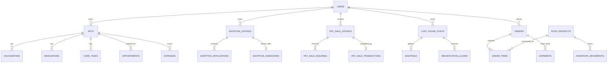

# PawCare — SQL Data Dictionary and Relational Rules

> **Status:** target schema specification, **not executable DDL**. The database migrations to be built later are authoritative.  
> **Database:** Oracle SQL exclusively, including development/testing with an isolated Oracle test PDB.  
> **Naming:** uppercase SQL tables and `snake_case` columns; API-facing JSON uses `camelCase`.

## 1. SQL modeling conventions

| Concept | Definition / rule |
| --- | --- |
| Primary key (`PK`) | Stable surrogate ID; choose a consistent SQL representation; public API IDs are opaque |
| Foreign key (`FK`) | Enforced; do not rely on API validation alone |
| Time | UTC timestamp with consistent precision and conversion; user IANA time zone separately |
| Money | Integer `*_minor` plus ISO `currency`; `CHECK(amount_minor >= 0)` where meaningful |
| Boolean | Oracle SQL representation as defined by migrations; expose boolean JSON consistently |
| Status | Documented controlled enum/check/reference, never arbitrary free text |
| Identity history | Prefer archive/status to destructive deletion for pets, orders, clinical records and audits |
| Personal data | Private by default; redacted DTOs for public listing projection |
| Media | Store object key + metadata + access policy, not unbounded image data directly in SQL |
| Soft deletion | `deleted_at`/archive status where needed; define retention and unique-key implications |
| Migration registry | Applied version, checksum, applied_at, provider; no silent reapplication |

**Critical ownership rule:** `PETS.owner_user_id` is the active owner. Historical transfer evidence remains in `ADOPTION_HANDOVERS` or `PET_SALE_TRANSACTIONS` and `AUDIT_EVENTS`. Do not rewrite history when ownership changes.

## 2. Original seven tables — preserved

| Table | Key fields (PK/FK) | Important columns and constraints |
| --- | --- | --- |
| `USERS` | `user_id PK` | `email UNIQUE NOT NULL`, `password_hash`, `role` (`OWNER/VET/ADMIN`), `status`, `created_at`, `updated_at`; email canonicalization policy |
| `PETS` | `pet_id PK`, `owner_user_id FK → USERS` | `name`, `species`, `breed`, `date_of_birth` nullable, `sex` nullable, `attributes` (bounded/validated), `created_at`, `updated_at`; ownership guard |
| `VACCINATIONS` | `vaccination_id PK`, `pet_id FK → PETS` | `vaccine_name`, `administered_at`, `next_due_at` nullable, `veterinarian_user_id` nullable FK, `notes`, provenance/author where appropriate |
| `MEDICATIONS` | `medication_id PK`, `pet_id FK → PETS` | `medication_name`, `dosage_text`, `instructions`, `start_at`, `end_at` nullable, `schedule_rule`, `created_by`; do not infer safe dosage |
| `CARE_TASKS` | `care_task_id PK`, `pet_id FK → PETS` | `task_type`, `title`, `due_at`, `recurrence_rule`, `status`, `completed_at`, `time_zone`, `created_at`; persist completion per occurrence if recurring |
| `APPOINTMENTS` | `appointment_id PK`, `pet_id FK → PETS`, `vet_user_id FK → USERS` | `starts_at`, `ends_at`, `status`, `reason`, `visit_notes`, `created_at`; validate `ends_at > starts_at` and avoid overlapping active slots |
| `EXPENSES` | `expense_id PK`, `pet_id FK → PETS` | `amount_minor`, `currency`, `category`, `occurred_at`, `description`, `created_by`; never return another owner's expense history |

**Implementation decision still needed:** recurring `CARE_TASKS` can represent schedule templates plus occurrences or an explicit occurrence table. Before implementing reminders, choose one durable no-duplicate occurrence design and document it in the SQL migration. Similarly, booking conflict constraints may need a transactional booking-slot strategy because a simple unique `(vet_id, starts_at)` does not prevent all interval overlap cases.

## 3. Accounts, media and operational tables

| Table | Fields and keys | Rules / sensitivity |
| --- | --- | --- |
| `USER_PROFILES` | `user_id PK/FK → USERS`, `display_name`, `phone_optional`, `preferred_time_zone`, preferences | Private fields; never expose contact details publicly by default |
| `USER_CAPABILITIES` | `capability_id PK`, `user_id FK`, `capability`, `granted_by FK`, `granted_at`, `revoked_at` | Seller/store operator approval as revocable capabilities; unique active grant |
| `SESSIONS` | `session_id PK`, `user_id FK`, `refresh_token_hash`, `expires_at`, `revoked_at` | Store token **hash**, never plaintext; rotate and invalidate |
| `ADDRESSES` | `address_id PK`, `user_id FK`, recipient/address fields, `scope`, `created_at` | Private shipping information; order also stores immutable snapshot |
| `FILE_ASSETS` | `file_id PK`, `owner_user_id FK`, `object_key UNIQUE`, `mime_type`, `size_bytes`, `access_policy`, `scan_status`, `created_at` | Private by default; strip EXIF/GPS; controlled signed access |
| `NOTIFICATIONS` | `notification_id PK`, `user_id FK`, `kind`, `payload`, `created_at`, `read_at` | Never embed secrets or unapproved precise locations in push body |
| `DEVICE_TOKENS` | `token_id PK`, `user_id FK`, `platform`, protected push token/lookup, `revoked_at` | Device tokens are sensitive; remove invalid registrations |
| `AUDIT_EVENTS` | `audit_id PK`, `actor_id FK` nullable for system, `action`, `entity_type`, `entity_id`, `happened_at`, `request_id`, `reason` | Append-only privileged/business transitions; scrub confidential payload |
| `OUTBOX_EVENTS` | `event_id PK`, `kind`, `payload`, `created_at`, `processed_at`, `retry_count`, `last_error_code` | Durable notifications/jobs; unique de-duplication key where needed |
| `IDEMPOTENCY_KEYS` | `key_id PK`, `user_id FK`, `operation`, `key_value`, `request_hash`, `response_ref`, `created_at`, `expires_at` | Unique `(user_id, operation, key_value)`; reject changed body with same key |

## 4. Adoption and optional monetary donations

| Table | Fields and keys | Rules / sensitivity |
| --- | --- | --- |
| `ADOPTION_LISTINGS` | `adoption_id PK`, `pet_id FK → PETS` nullable, `creator_id FK → USERS`, `title`, `description`, `species`, `general_area`, `status`, `posted_at`, `reviewed_by` nullable | Only `PUBLISHED` public. `pet_id` optional when rehoming a rescue animal not in PETS; document how transfer creates/links the pet. No private owner address in public response. |
| `ADOPTION_APPLICATIONS` | `application_id PK`, `adoption_id FK`, `applicant_id FK`, `answers_private`, `status`, `submitted_at`, `reviewed_at` | Restrict applicant details to owner+authorized reviewer; one active application per applicant/listing unless policy permits resubmission |
| `ADOPTION_HANDOVERS` | `handover_id PK`, `adoption_id FK UNIQUE`, `prior_owner_id FK`, `new_owner_id FK`, `owner_confirmed_at`, `adopter_confirmed_at`, `confirmed_at` | Both confirmations; one final ownership transfer per listing; log before/after owner ID |
| `DONATION_CAMPAIGNS` | `campaign_id PK`, `beneficiary_id FK`, `purpose`, `goal_minor`, `currency`, `verification_status`, `status` | **Optional feature**; verified, lawful beneficiaries only; cannot publish before required checks |
| `DONATION_CONTRIBUTIONS` | `contribution_id PK`, `campaign_id FK`, `donor_id FK` nullable, `amount_minor`, `currency`, `payment_state`, `provider_ref` | Optional; signed payment confirmation and refunds, never store raw card data |

**Clarification:** “pet donation” = rehoming/transfer through adoption, not necessarily donating money. The two monetary donation tables are optional and must not block the core adoption workflow.

## 5. Lawful animal-sale marketplace

| Table | Fields and keys | Rules / sensitivity |
| --- | --- | --- |
| `PET_SALE_LISTINGS` | `sale_listing_id PK`, `pet_id FK → PETS`, `seller_id FK → USERS`, `title`, `asking_minor`, `currency`, `species`, `welfare_evidence_file_id FK`, `status`, `posted_at`, `reviewed_by` | Seller must have active approved capability; species/age/welfare and local legality verified; only `ACTIVE` public |
| `PET_SALE_INQUIRIES` | `inquiry_id PK`, `sale_listing_id FK`, `buyer_id FK`, `message_private`, `status`, `created_at` | Only buyer, seller and justified moderator access; rate limits |
| `PET_SALE_TRANSACTIONS` | `sale_txn_id PK`, `sale_listing_id FK UNIQUE`, `buyer_id FK`, `agreed_minor`, `currency`, `handover_state`, `completed_at` | One completed sale per listing; no food-shipping relation; permanent audit |
| `LISTING_REPORTS` | `report_id PK`, `reporter_id FK`, `listing_type`, `listing_id`, `reason_code`, `details_private`, `review_state`, `created_at` | Reporters cannot see moderation-only evidence; prevent report spam |
| `FAVORITES` | `favorite_id PK`, `user_id FK`, `entity_type`, `entity_id`, `created_at` | Unique `(user_id, entity_type, entity_id)`; validate polymorphic target in application or normalized schema |

If a seller can list a pet only once at a time, enforce no simultaneously active/pending sale or adoption listings for that pet. This cross-listing rule needs service + transactional enforcement (and optionally an indexed lock/reference table).

## 6. Lost and found

| Table | Fields and keys | Rules / sensitivity |
| --- | --- | --- |
| `LOST_FOUND_POSTS` | `post_id PK`, `pet_id FK → PETS` nullable, `poster_id FK`, `category` (`LOST`/`FOUND`), `description`, `general_area`, `geo_radius`, `status`, `observed_at`, `created_at` | **Never make raw exact coordinates/contact a public projection**; use approximate area only |
| `SIGHTINGS` | `sighting_id PK`, `post_id FK`, `reporter_id FK`, `approximate_area`, `observed_at`, `description_private`, `created_at` | Restricted to poster and assigned reviewer; suspicious reports triaged |
| `REUNIFICATION_CLAIMS` | `claim_id PK`, `post_id FK`, `claimant_id FK`, `proof_asset_id FK → FILE_ASSETS`, `status`, `reviewed_by`, `resolved_at` | Proof private, verification before reunion, redact metadata, log decision |

A `FOUND` report must not transfer an animal to a claimant without privately confirming ownership and following appropriate local safety procedures.

## 7. Pet food catalogue and order fulfillment

| Table | Fields and keys | Rules / sensitivity |
| --- | --- | --- |
| `FOOD_CATEGORIES` | `category_id PK`, `parent_id FK nullable`, `name`, `slug UNIQUE`, `status` | Prevent cyclic parent categories |
| `FOOD_PRODUCTS` | `product_id PK`, `category_id FK`, `sku UNIQUE`, `brand`, `title`, `description`, `price_minor`, `currency`, `status`, `created_at` | Food only; accurate ingredients/quantity, `price_minor >= 0` |
| `PRODUCT_IMAGES` | `product_image_id PK`, `product_id FK`, `file_id FK`, `sort_order` | Unique product/order; approved media only |
| `INVENTORY_MOVEMENTS` | `movement_id PK`, `product_id FK`, `quantity_delta`, `reason`, `reference_id`, `created_at` | Append-only movement ledger; also define atomic available-stock reservation/read model |
| `CARTS` | `cart_id PK`, `user_id FK UNIQUE`, `version`, `updated_at` | One active cart per user; version for stale concurrent updates |
| `CART_ITEMS` | `cart_item_id PK`, `cart_id FK`, `product_id FK`, `qty` | Unique `(cart_id, product_id)`, `CHECK(qty > 0)` |
| `ORDERS` | `order_id PK`, `user_id FK`, `shipping_address_snapshot`, `subtotal_minor`, `shipping_minor`, `tax_minor`, `total_minor`, `currency`, `status`, `created_at` | Immutable price/address snapshot, final total computed on server; no pets in food order lines |
| `ORDER_ITEMS` | `order_item_id PK`, `order_id FK`, `product_id FK`, `qty`, `unit_price_minor`, `line_total_minor`, `currency` | Snapshot unit price, `qty > 0`, `line_total_minor = qty * unit_price_minor` consistently |
| `PAYMENTS` | `payment_id PK`, `order_id FK nullable`, `sale_txn_id FK nullable`, `contribution_id FK nullable`, `provider_ref`, `amount_minor`, `currency`, `state`, `created_at` | Provider reference unique per provider, signature verified, no raw PAN/CVV. If multiple target types permitted, exactly one target is non-null and the target is legally supported. |
| `SHIPMENTS` | `shipment_id PK`, `order_id FK`, `carrier`, `tracking_ref`, `status`, `shipped_at`, `delivered_at` | **Food orders only**, never live pet delivery |
| `PRODUCT_REVIEWS` | `review_id PK`, `product_id FK`, `buyer_id FK`, `order_item_id FK`, `rating`, `review_text`, `moderated_at` | `CHECK(rating BETWEEN 1 AND 5)`; verified purchase only; one review per allowed order item |

**Payment boundary:** the blueprint includes `PAYMENTS` references for multiple transaction types but only **food-store payment** is in the initial committed commerce scope. Money campaigns and pet-sale payment need explicit legal/product approval. Do not infer they are enabled from the existence of a column.

## 8. Relationship sketch

## 9. SQL migration plan

| Migration | Scope |
| --- | --- |
| `V001_core_care.sql` | `USERS`, `PETS`, `VACCINATIONS`, `MEDICATIONS`, `CARE_TASKS`, `APPOINTMENTS`, `EXPENSES` |
| `V002_identity_profiles.sql` | Profiles, capability grants, sessions, addresses |
| `V003_assets_notifications_audit.sql` | File assets, notifications, device tokens, audit |
| `V004_adoption.sql` | Adoption listings, applications, handovers |
| `V005_donations.sql` | **Optional** verified monetary campaigns/contributions |
| `V006_pet_marketplace.sql` | Sale listings, inquiries, transactions |
| `V007_moderation_favorites.sql` | Reports, favorites, moderation history |
| `V008_lost_found.sql` | Lost/found posts, sightings, reunification claims |
| `V009_food_catalog_inventory.sql` | Categories, products, images, movements |
| `V010_cart_orders.sql` | Carts, items, orders, order lines |
| `V011_payments_delivery_reviews.sql` | Payment, shipment, product reviews |
| `V012_outbox_keys_indexes.sql` | Outbox, idempotency, views, indexes and final constraints |

**Dependency caution:** some tables listed earlier reference `FILE_ASSETS` (V003), and `PAYMENTS` (V011) references donation/sales entities (V005/V006). Tests must apply migrations in order. If monetary fundraising is postponed, keep schema consistent but do not expose public feature routes.

Only `database/oracle/` migrations are supported. Apply and verify their Oracle identity columns, check constraints, and locking rules against a dedicated Oracle test schema.

## 10. Constraints, indexes and concurrency requirements

**Uniqueness:** `USERS.email`, `FOOD_PRODUCTS.sku`, `FOOD_CATEGORIES.slug`, `CARTS.user_id`, `(CART_ITEMS.cart_id, product_id)`, `(FAVORITES.user_id, entity_type, entity_id)`, `ADOPTION_HANDOVERS.adoption_id`, `PET_SALE_TRANSACTIONS.sale_listing_id`, and `IDEMPOTENCY_KEYS(user_id, operation, key_value)`.

**Recommended indexes:** `PETS(owner_user_id)`, `APPOINTMENTS(vet_user_id, starts_at, status)`, `ADOPTION_LISTINGS(status, posted_at)`, `PET_SALE_LISTINGS(status, posted_at)`, `LOST_FOUND_POSTS(status, general_area)`, `ORDERS(user_id, created_at)`, `FOOD_PRODUCTS(category_id, status)`, `SIGHTINGS(post_id, observed_at)`, `NOTIFICATIONS(user_id, read_at)`.

**Transactions:** inventory mutation + order creation; appointment conflict check + booking; adoption/sale handover + owner update + audit; claim verification + report closure; payment webhook de-duplication + state update.

**Testing:** migration on blank DB, rerun detection, foreign-key checks, unique/check constraints, rollback drills, concurrent checkout/bookings, outbox and audit replay, Oracle integrity checks.

## 11. Open design decisions before writing DDL

1. PK strategy and JSON ID encoding (numeric ID, UUID or prefixed opaque external ID).
2. Care recurring occurrence table or durable generated task records.
3. Exact appointment time interval granularity and database locking approach.
4. Media access policy vocabulary, private proof retention and user deletion workflows.
5. Full seller verification schema and moderation decision history table(s).
6. Inventory available-to-sell calculation and reservation expiration strategy.
7. Supported regions/currencies, food tax/shipping calculation and payment provider.
8. What constitutes a legal animal listing in the launch jurisdiction.

The above choices are **proposals/decisions to implement**, not claims about already-written migration files. Cross-reference [architecture.md](architecture.md), [api-contracts.md](api-contracts.md), [permissions-matrix.md](permissions-matrix.md), [trust-and-safety.md](trust-and-safety.md) and [acceptance-tests.md](acceptance-tests.md).
