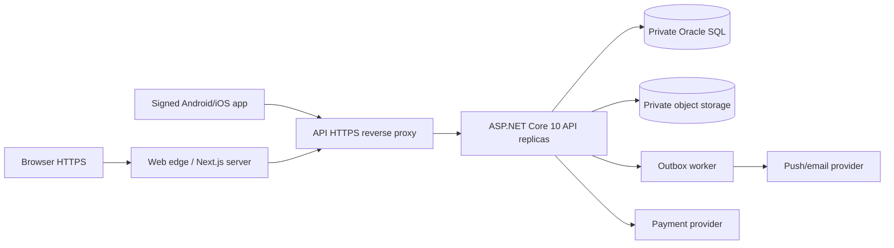

# PawCare — Development, Deployment and Operations Runbook

> **Status:** target deployment plan, **not proof that build/deploy pipelines or environment files are implemented**.  
> **Stack:** ASP.NET Core 10 API, Next.js 16 web, React Native/Expo 58 mobile, Oracle Database for production and isolated testing.

## 1. Environments and architecture

| Environment | Web | Mobile | API | SQL | Security |
| --- | --- | --- | --- | --- | --- |
| Local development | Next dev server, typical `localhost:3000` | Expo Metro on LAN; real Android recommended | .NET 10, typical `localhost:5080` or trusted LAN binding | Isolated Oracle PDB | Dev-only HTTP permitted on trusted private LAN, no external exposure |
| CI | Reproducible build/test | Type check, JS bundle and tests | Build/tests | Oracle integration only on explicitly authorized isolated runner | Secret-free test fixtures |
| Staging | HTTPS domain | Internal/staging build | HTTPS gateway | Isolated Oracle test schema | Production-like roles, provider sandboxes and audit |
| Production | HTTPS, secure session relay | Signed standalone Android/iOS builds | HTTPS behind trusted reverse proxy | Private Oracle | Secret manager, least privilege, monitoring, backups |

**Never use a production Oracle database as the automated-test target.** Treat staging and production database accounts, storage buckets, payment provider keys and push credentials as independent.

## 2. Project prerequisites

- Git and PowerShell on Windows for the expected local workflow.
- Node.js **22** for the currently agreed GitHub CI baseline; npm lockfiles under `frontend/` and `mobile/` once those apps are generated.
- .NET **10 SDK/runtime**; verify via `dotnet --info`. Do not build against a runtime that isn't installed in CI/prod.
- Expo tooling through project-local `npx.cmd` (avoid relying on global CLI); physical Android phone with Expo Go for supported preview flows and development builds for native functionality.
- An isolated Oracle development/test PDB and the versioned Oracle migrations.
- A reviewed private object-storage and payment-provider adapter if those modules are built.

```powershell
node --version
npm.cmd --version
dotnet --info
```

## 3. Proposed configuration separation

> Exact environment-variable names below are **design recommendations**, not a claim that your existing code already reads them. Wire and validate them during implementation.

| Location | Proposed setting | Public? | Notes |
| --- | --- | --- | --- |
| Backend config | `ConnectionStrings__PawCare` | **No** | DB credentials/passwords only server-side |
| Backend config | `Jwt__SigningKey` | **No** | Strong rotated key from secret manager; do not commit |
| Backend config | `Storage__Bucket`, `Storage__Credentials` | **No** | Private media storage + signed URL service |
| Backend config | `Payments__WebhookSecret` | **No** | Verify callbacks; only when food payments enabled |
| `frontend/.env.local` | `PAWCARE_API_URL` | **Server-only** | Internal API origin; same-origin relay to browser |
| `mobile/.env` | `EXPO_PUBLIC_API_URL` | **Yes** | URL embedded in app; must not contain secrets |
| Web/mob build config | Public product name, safe environment label | Yes | No tokens, DB credentials or internal-only URLs |

Example **local phone** setting only after verifying PC LAN IP and backend network binding:

```dotenv
EXPO_PUBLIC_API_URL=http://192.168.1.30:5080/api/v1
```

This address is **illustrative**, may change with your network, and must not be used in production. The health route is `http://<PC-IP>:5080/api/health` (outside `/api/v1`).

**Local `.env` and `.env.local` files should be gitignored**, with sanitized `.env.example` templates committed. Sensitive URLs, bearer credentials, proofs or private addresses are forbidden in client-side environment variables and logs.

## 4. Local first-run procedure (as components are implemented)

From repository root `PawCare/`:

1. Clone repository and check `.github/workflows`, `docs`, and the SQL migration directories.
2. Install backend SDK and Node dependencies. Use `npm.cmd ci` in each app when `package-lock.json` exists; do not use lockfile-free installs in CI.
3. Create local config from example, supply a strong dev signing key and Oracle connection string, and run database migrations in exact order.
4. Start API and confirm liveness/SQL readiness, then start the web client.
5. Start Metro and launch Expo on a real phone connected to a permitted same LAN.
6. Run smoke tests for login and pet CRUD, then end-to-end task/checkout workflows when implemented.

Illustrative commands, **only after source files are built**:

```powershell
# Terminal A — API, from PawCare root
cd .\backend\PawCare.Api
dotnet restore .\PawCare.Api.csproj
dotnet build .\PawCare.Api.csproj
# Normal host (on a machine whose security policy permits it):
dotnet run --project .\PawCare.Api.csproj
```

If a *locally authorized* Windows Application Control policy blocks a generated `.exe` but allows the official managed entry point, the .NET framework-dependent DLL can be started directly after building:

```powershell
# From backend\PawCare.Api
dotnet .\bin\Debug\net10.0\PawCare.Api.dll
```

This is not permission to circumvent an organization-managed restriction; seek approved policy adjustments if DLL launch is also prohibited. Do not disable Defender, Code Integrity or firewall globally.

```powershell
# Terminal B — Web, from PawCare root once frontend/package.json exists
cd .\frontend
npm.cmd ci
npm.cmd run dev

# Terminal C — Expo, from PawCare root once mobile/package.json exists
cd .\mobile
npm.cmd ci
npx.cmd expo start --clear
```

The planned root `start.bat`, `start-mobile.bat` and `scripts/*.ps1` are convenience wrappers. They must not claim success without checking API health or masking startup failures. Do not rely on current launcher behavior while rebuilding.

## 5. Physical Android device setup

1. Put PC and phone on the **same trusted Wi-Fi/LAN**, not guest/client-isolated Wi-Fi.
2. Determine PC local IPv4 address (`ipconfig`); confirm it matches Metro address if applicable.
3. For LAN testing only, bind API to an interface reachable from phone; e.g. from backend project directory:

   ```powershell
   dotnet .\bin\Debug\net10.0\PawCare.Api.dll --urls "http://0.0.0.0:5080"
   ```

4. Restrict Windows Firewall permission to the trusted **Private** network and the minimum required port. Never expose `5080` on the public internet via router forwarding.
5. Check from PC and phone browser: `http://<PC-LAN-IP>:5080/api/health`. A healthy API should return an intentional result; a timeout/refusal means connectivity is not established.
6. Set `mobile/.env` to `EXPO_PUBLIC_API_URL=http://<PC-LAN-IP>:5080/api/v1`, restart Metro and fully reload the app.
7. `10.0.2.2` refers to the standard Android emulator host mapping, **not** a physical phone. `localhost` on the phone means the phone itself.
8. Prefer HTTPS staging with a valid certificate for sensitive testing. Plain HTTP should be restricted to local trusted development and may require platform-specific Android networking configuration.

**Health test vs business test:** Passing `/api/health` only confirms API reachability. Verify JWT/login, database migrations and permitted pet requests separately.

## 6. SQL migrations and release safety

```text
database/
└── oracle/
    ├── 000_create_schema.sql
    ├── migrations/V001_*.sql ... V012_*.sql
    ├── queries/
    ├── verification/
    ├── rollback/
    └── seeds/
```

- Apply migration versions in order, track checksums; refuse unexpected modified migrations.
- Test Oracle migrations and transactional behavior on an isolated Oracle test PDB; no other SQL provider is supported.
- For production, take verified backup/snapshot, execute migration through controlled release job with least privilege, validate postconditions and record result.
- Prefer additive expand/migrate/contract schema updates for zero/low downtime; destructive rollback may need **restore** rather than reverse SQL.
- **Never apply demo seeds to production**; prevent deletion of real medical, order or audit history by fixture scripts.

## 7. CI, security and release artifacts

Existing proposed workflow filenames:

```text
.github/workflows/ci.yml
.github/workflows/security.yml
.github/dependabot.yml
```

- CI: .NET build/tests, web lint/type check/tests/build, mobile type check/tests/bundle, Oracle-specific source/integrity checks, Git diff checks.
- Security: NuGet/npm vulnerability audit, CodeQL where eligible, dependency review and future secret scanning.
- Dependabot: reviewed dependency update PRs; **never** auto-deploy unchecked major updates.
- Add Oracle integration, image scanning, web/mobile E2E, release signing and deployment approvals when operational infrastructure exists.
- A passing bootstrap CI while app directories are absent is **not** evidence that a complete PawCare application has passed CI. Require all relevant jobs once source is present.

## 8. Production deployment reference design



**Minimum production controls**

- HTTPS on all public endpoints with HSTS where suitable; redirect HTTP, use managed certificates and explicit trusted proxy configuration.
- API/database on private networks; Oracle credentials scoped and rotated, never in Next.js public runtime or mobile bundle.
- Restrictive CORS for direct API consumers; web same-origin relay reduces browser cross-origin exposure. CORS is not authentication.
- Signed app builds with tested deep links, token secure storage, push permissions and networking; do not ship Expo Go as end-user production app.
- Payment provider signing keys, webhook verification, transaction outbox, refund reconciliation and inventory consistency checks.
- Object storage private by default; controlled short-lived URLs, upload scanning, metadata stripping, retention rules and CDN cache restrictions.
- Structured logs with redaction, service/SQL metrics, tracing/request IDs, alert thresholds, backups and tested restore drills.
- Accessibility and safety policy approvals for adoption, animal sale and lost/found before public opening.

**Exact cloud vendor, DNS names, payment provider and Oracle hosting mode remain open design choices.** This document does not invent deployment credentials or domains.

## 9. Release, rollback and incident playbooks

### Release checklist

1. Reviewed PR, green relevant CI/security/E2E checks and zero unresolved critical authorization issues.
2. Migration review/backup/restore rehearsal; release notes and monitored rollout window.
3. Deploy backend compatible with current clients; maintain API version compatibility.
4. Deploy Next.js; publish signed mobile builds through appropriate distribution channel.
5. Verify health/readiness, auth, role access, adoption/lost privacy, marketplace moderation and food checkout sandbox tests.
6. Watch error rate, API latency, outbox backlog, payment mismatches, stock negatives and moderation alerts.

### Rollback

- Stop new feature exposure using reviewed server feature flags; do not undo order/transfer history.
- Roll back backend/web **only if schema backwards compatibility permits**.
- For irreversible data changes follow tested restore/forward-fix procedure with incident log and reconciliation.
- On payment incident, pause checkout, reconcile provider ledger, do not blindly retry charges.
- On animal-listing safety incident, suspend affected listing categories and notify moderators; do not publish private investigation data.

### Incident severity and ownership

- **SEV1:** unauthorized medical/proof exposure, animal-safety risk, payment duplication or widespread authentication bypass → immediate access reduction, human incident lead, preserve evidence.
- **SEV2:** degraded checkout, failed appointments, significant outage → rollback/repair and user status communication.
- **SEV3:** isolated UX glitch/non-critical error → normal triage with request ID.

Define ownership, contact tree, backup frequency, RPO/RTO and region-specific incident notification requirements **before launching production**; no arbitrary numbers are asserted here.

## 10. Deployment acceptance checks

- [ ] Clean developer machine can run API, web and mobile with controlled config.
- [ ] A real physical Android phone can reach API health and complete authenticated actions.
- [ ] Secrets never appear in client bundles, logs, git history, QR payloads or public configuration.
- [ ] Production SQL migrations and backups are validated; rollback/recovery is rehearsed.
- [ ] HTTPS, CORS, authorization, image access and payment callbacks pass integration/security tests.
- [ ] End-user food transactions, animal transfers and moderator actions remain auditable.
- [ ] Crash/error monitoring, API health probes, notifications and retention policies operate as intended.

See [architecture.md](architecture.md), [trust-and-safety.md](trust-and-safety.md) and [acceptance-tests.md](acceptance-tests.md).
