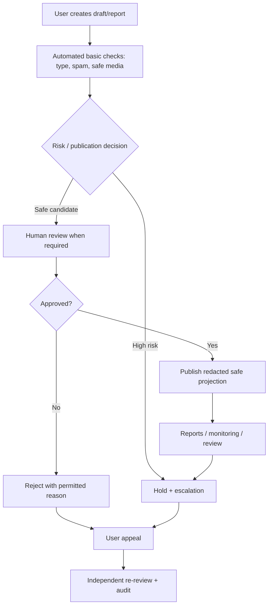

# PawCare — Trust, Safety, Animal Welfare and Privacy

> **Status:** required platform policy and implementation specification; **not a claim of regulatory compliance or completed moderation**.  
> **Launch dependency:** validate applicable animal, privacy, consumer, payment and advertising laws with competent local review in each operating jurisdiction.

## 1. Principles

PawCare must support responsible pet care without enabling animal cruelty, illegal trade, fraud, unsafe handover, location stalking, harassment, financial abuse or disclosure of sensitive personal records.

**Core rules**

1. **Welfare before volume:** do not publish unsupported species, suspicious animal age/condition, illegal/wildlife trade or evidence of abuse.
2. **Moderation before public visibility:** adoption and animal-sale posts require review; reports and removals are traceable.
3. **Privacy by design:** public discovery gets generalized location and redacted identity; proof and medical documents remain private.
4. **Safety without overclaiming:** verification badges reflect completed checks; never claim that a seller or adopter is risk-free.
5. **Separate live-animal transactions from food commerce:** food can ship through the store. Live pets must not be put through the normal shipping/checkout workflow.
6. **Accessible decisions and appeals:** users receive actionable explanations for rejections, removals, suspensions and appeals without exposing protected investigation details.
7. **Least privilege:** one request or moderator role does not grant broad access to all personal or clinical data.

## 2. Supported and prohibited content

| Context | Allowed when policy conditions met | Prohibited / hold for review |
| --- | --- | --- |
| Adoption | Lawful rehoming of eligible companion animals, informed applicants, safe handover | Selling disguised as donation, animal exploitation, fraudulent ownership, unlawful species |
| Marketplace | Regionally lawful companion-animal listings by reviewed sellers | Protected/illegal wildlife, illicit breeding, prohibited age/condition, abuse, false welfare documents, live-animal shipping |
| Lost/found | Credible lost/found alerts, approximate area, private sightings | Exact home location, doxxing, stalking, threats, unverified ownership claims |
| Food store | Lawful pet-food products with reliable ingredients, unit sizes and truthful claims | Counterfeit, expired, recalled, prohibited or unsafe items; unsupported medical cure claims |
| Photos / text | Relevant pet photos, accurate descriptors, appropriate care info | Graphic cruelty for promotion, deceptive identity, threats, hateful harassment, personal contact information posted without consent |
| Monetary campaigns (optional) | Verified lawful beneficiaries, purpose and refund disclosures | Unverified fundraising, misleading beneficiaries, concealed fees, self-dealing, fraudulent claims |

Local rules can be stricter than these platform defaults. Define a reviewed **species allowlist** and region-based policy before market launch. Do not automatically enable pet sale everywhere merely because a listing table exists.

## 3. Adoption and animal donation safeguards

1. Poster declares lawful ownership/custody, species, approximate age, health disclosures and reason for rehoming.
2. Attachments are malware-scanned, metadata-stripped, stored privately and reviewed as needed.
3. Listing begins `DRAFT`; submit for `PENDING_REVIEW`; only admin-approved `PUBLISHED` listing appears publicly.
4. Applicants submit private information and acknowledge safety/eligibility guidance; applications are not visible to other applicants.
5. Poster selects a candidate only after screening; the product displays consent-based meeting guidance (public safe location, no pressured handover).
6. **Handover requires explicit confirmations** from both parties and any required identity/ownership checks. Do not auto-transfer pet ownership when an application is accepted.
7. Record a durable audit trail of original owner, new owner, status and timestamp; allow appropriate support escalation.

**Adoption must not be used as a back door for paid animal listings.** If fees are allowed in some jurisdictions (e.g., documented rescue costs), require transparent policy/legal review rather than representing them as an unchecked sale or donation.

## 4. Animal marketplace safeguards

### Seller onboarding

- Account authentication and verified seller capability issued by an authorized admin, with evidence, expiry and revocation process.
- Document which jurisdictions/species are supported, legal minimum ages, appropriate vet/welfare evidence and permitted sale practices. The values are **jurisdiction-specific, not assumed in this specification**.
- Prevent the seller from approving their own listing or modifying verification state in client JSON.
- Detect repeated duplicate listings, inconsistent animal data, reused photos and cross-listed animals awaiting adoption or sale.

### Buyer protection and handover

- Show seller verification **status**, listed animal characteristics, condition notes, general area, fair fee disclosure and an obvious safety-report action.
- Keep contact details private until both parties opt in to a specific interaction. Prefer in-app inquiry rather than displaying personal phone numbers.
- Encourage meeting in a safe agreed location, careful review of welfare/health documentation, identity verification and non-coercive decision making.
- Use explicit agreement and handover confirmation. Exactly one finalized transaction per listing; require audit on cancellation and dispute.
- **No live-animal delivery option** in the pet-food cart, orders, shipment tables or courier integration.
- If the launch jurisdiction prohibits a particular type of sale, the platform must disable it, not rely on a disclaimer.

### Escalation

Temporarily hold listings that involve suspected abuse, illegal trade, forged documents, scams, risky animal age or repeated account evasion. Escalate appropriate evidence for manual review and, where required and legally justified, appropriate external reporting. Avoid publishing allegations as fact without investigation.

## 5. Lost-and-found privacy and reunification

- Public cards may show species, pet description, date/time and **generalized area** (city/district or approximate radius), not exact coordinates or personal residence.
- Strip GPS EXIF from all uploaded photos before public delivery. Don't leak precise location through map tile coordinates, API response, file names or analytics.
- Sightings and ownership claims are private to authorized poster/claimant/moderator; proof images are protected.
- Never reveal the claimant's or finder's telephone number automatically. Contact exchange requires consent.
- Suspicious claimants must verify animal-specific details privately. Neither a public post nor possession of a photo proves ownership.
- Reunion closure is a verified state change with audit and appropriate mutual confirmation; allow false-report reversal by support process without deleting event history.
- Do not offer precise notification geofencing or real-time location tracking by default; prefer coarse-area opt-in alerts.

## 6. Food store consumer safety

- Require clear product identity, pet suitability context, quantity/unit weight, price, stock status, ingredient/allergen details when supplied, responsible seller, shipping charges and refund/return policy.
- Support handling for expired/withdrawn/recalled products: suspend product display and purchases, identify affected orders and notify buyers where appropriate.
- Inventory is managed transactionally; concurrent checkouts cannot oversell. Product reviews should be labeled as verified purchase only when actual order history supports it.
- Never imply a food product cures a disease unless the product and jurisdiction-specific regulations support such a claim. A food category is not veterinary treatment.
- Payment details belong to an approved payment provider, not PawCare's raw storage; verify webhooks and handle refunds idempotently.

## 7. Monetary donations (optional extension)

“Pet donation” in the core scope is **pet rehoming/adoption**. Monetary fundraising is optional and **off by default** until the following exist:

- Verified beneficiary identity and eligibility; transparent funds destination and purpose.
- Payment provider agreement and jurisdiction/legal review.
- Receipts, refunds, failed/chargeback handling and financial reconciliation.
- Fees and usage disclosure; a policy for suspected misuse and suspended campaigns.
- Separate permission grants, audit events, complaint/appeal handling and privacy notice.

Do not add public fundraisers or a live payment endpoint solely because `DONATION_CAMPAIGNS`/`DONATION_CONTRIBUTIONS` tables are in the schema blueprint.

## 8. Trust and moderation workflow

Define a moderation checklist at review time: lawful species/age, custody, credible photos, consistency with other listings, contact privacy, suspected fraud/scam, explicit banned content, and any region-specific policy. A moderator may request more evidence without making documents public.

### Enforcement levels

| Level | Example | Response |
| --- | --- | --- |
| Informational | Missing description/photo | Draft feedback; no public listing |
| Low risk | Unclear welfare details | Hold for edits / manual review |
| Medium risk | Repeated spam or conflicting information | Temporarily restrict publishing, verify account |
| High risk | Suspected sale of prohibited wildlife, abuse, doxxing, serious fraud | Immediate hold/remove, preserve necessary evidence, escalate |
| Confirmed severe violation | Documented repeated illegal/abusive activity | Suspend/revoke, appeals path, legally appropriate further action |

Track `listing_id`, reviewer, decision, reason code, request ID and timestamps in audit/moderation history. Expose limited status/reason to affected users; don't expose reporters' identities or unrelated confidential evidence.

## 9. Privacy, data protection and retention

| Data | Public? | Access / handling |
| --- | --- | --- |
| Approved pet listing basics | Yes, **redacted** | General area; published media sanitized |
| Owner email/phone/home address | No | Owner and narrowly scoped authorized operations |
| Pet medical record/documents | No | Owner and assigned/consented vet; logged admin exceptions |
| Adoption application details | No | Applicant own data; listing poster selected fields; authorized reviewer |
| Seller identity evidence | No | Verification reviewers only |
| Lost/found sighting or claim proof | No | Involved parties by need; designated moderators |
| Shipping address/order info | No | Buyer and scoped fulfillment operator |
| Payment card data | Never stored by PawCare | Approved provider; retain only safe references/states |
| Tokens/secrets | Never public | Server secrets manager; secure client storage as appropriate |

- Obtain informed consent for optional location, push and marketing notifications; honor withdrawal.
- Data minimization: collect only what a workflow needs, avoid unnecessary birthdate/identity fields for applicants.
- Define jurisdiction-appropriate retention and deletion schedules for reports, rejected listings, documents, payment references, logs and backups **before production**; exact periods are deliberately not invented here.
- Provide user-facing privacy notice, contact for data requests and procedure to delete/anonymize where legally allowed without destroying required transaction/audit records.
- Enforce deletion access rules in object storage as well as SQL. Do not accidentally leak private media through public CDN caches.

## 10. Security and abuse prevention controls

- Secure password hashing, JWT verification, refresh rotation, TLS, rate limits, session revocation and scoped admin MFA.
- Check access control on every record ID, not just a page route (IDOR tests).
- Limit image MIME/type, actual file signature, size and dimensions; malware scan; reject dangerous content and strip EXIF.
- Rate-limit authentication, listing creation, reports, messages, sightings, contact requests and checkout.
- Audit moderator actions, financial state changes and ownership transfers; scrub PII and secrets from logs.
- Add account recovery and suspicious-login behavior; never disclose user existence during password reset.
- Monitor coordinated abuse (spam reports, fraudulent sightings, payment replay, bot scraping) with proportionate controls.

## 11. Safety acceptance criteria

- [ ] Only approved lawful animal listings are public; excluded species/age rules enforced server-side.
- [ ] Adoption or sale ownership cannot change without required verified handover events.
- [ ] No live animal can enter food cart, delivery or shipment pipelines.
- [ ] Public lost/found API and photos reveal no precise location/contact or metadata leakage.
- [ ] Unsafe content can be reported, reviewed, removed and appealed with a recorded audit trail.
- [ ] Private medical, proof, identity, order and applicant data fail cross-user access tests.
- [ ] Food payment and refund actions cannot be replayed to double-charge or duplicate fulfillment.
- [ ] Privacy, animal welfare, returns/refunds, moderation and seller terms are approved before launch.

Cross-reference [permissions-matrix.md](permissions-matrix.md), [api-contracts.md](api-contracts.md), [data-dictionary.md](data-dictionary.md), [deployment.md](deployment.md) and [acceptance-tests.md](acceptance-tests.md).
